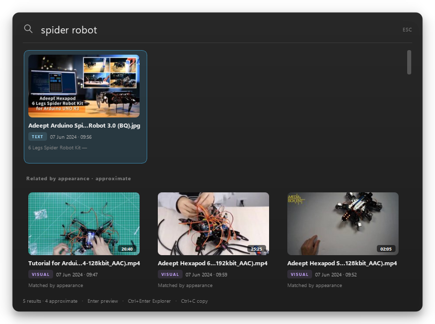

# ShotFinder

Find any screenshot, photo or video by the text inside it or by what it shows.
Everything runs on your own Windows PC.

<!-- Demo GIF: record ~15 s (hotkey, one query, a video jumping to its spoken line),
     save it as docs/screenshots/demo.gif, then replace the line below with
      -->
*Demo GIF: `docs/screenshots/demo.gif` (recording pending).*

**[Download for Windows](https://github.com/brighinatommaso-eng/shotfinder/releases/latest)**
· [How to build it yourself](#build-from-source) · [Known limitations](#known-limitations)

## What it does

You know the screenshot exists. You just cannot find it.

ShotFinder reads the text in your screenshots and photos, recognises what the
pictures show, and listens to what is said in your videos. Then you type
whatever you remember and it opens the file — or the exact minute of the video.

It watches the folders you choose, keeps a local index, and stays out of the way
in the system tray.

## Quick start

1. **Download and unzip.** Get `ShotFinder-0.1.1-win64.zip` from the
   [releases page](https://github.com/brighinatommaso-eng/shotfinder/releases/latest)
   and extract it anywhere, for example `C:\Users\you\Desktop\ShotFinder`.
   Double-click `ShotFinder.exe`.

   Windows may show "Windows protected your PC" because the app is not signed
   yet. Click **More info → Run anyway**. It is a plain local program; nothing
   is installed and nothing needs administrator rights.

2. **Pick your folders.** On the first launch a welcome window offers
   Screenshots, Pictures, Videos and Downloads. Untick what you do not want,
   then click **Start**. ShotFinder downloads about 635 MB of models once, in
   the background. Text search works immediately; visual and spoken search turn
   on when the download finishes.

3. **Search.** Press `Ctrl+Alt+Space` (or click the tray icon) and type.

That is it. New files are picked up automatically from then on.

## Three example queries

| You type | What it finds |
| --- | --- |
| `fattura enel` | The screenshot where that text is written, even if the file is called `IMG_2024_11_03.png`. |
| `a beach at sunset` | Photos and video moments that *look* like that. These appear in a separate "Related by appearance" group, because visual matching is a suggestion, not a fact. |
| `quick brown fox` | The video where someone says it. The result shows the line and its timestamp, and the player starts two seconds earlier. |

Text queries work in Italian and English against the same visual index.

## What you need

- Windows 10 or 11, 64-bit.
- About 700 MB of free space for the models, plus room for the index
  (roughly a few hundred MB for tens of thousands of files).
- No Python, no account, no configuration files.

## Privacy

Everything stays on this PC.

- The index, the models and the logs live in `%LOCALAPPDATA%\ShotFinder`.
- The only network access is the one-time model download.
- No telemetry, no accounts, no uploads, no cloud sync.
- Files that exist only in OneDrive/the cloud are skipped, never downloaded
  behind your back.

## Settings

Right-click the tray icon → **Settings…**

- **Watched folders** — add or remove folders. Removing one also deletes its
  files from the index.
- **Indexing** — turn video frames or speech transcription off, and set how long
  a video may be before speech is skipped (default 60 minutes).
- **Search hotkey** — click the field, press a combination; Windows checks that
  it is free before saving it.
- **Start with Windows** — a per-user setting, no administrator needed.
- **Index** — how many files, videos and frames are indexed, the database size,
  and **Rebuild index** (deletes the index and scans everything again).

The tray menu also pauses indexing, opens the data folder and quits the app.

## Using it

| Key | Action |
| --- | --- |
| `Ctrl+Alt+Space` | Open the search window (configurable) |
| Arrows | Move between results |
| `Enter` | Preview the selected file |
| `Ctrl+Enter` | Show the file in Explorer |
| `Ctrl+C` | Copy the image to the clipboard |
| `Space` | Play or pause a video |
| `Esc` | Close the window |

An empty query lists recent files. Videos open at the matched moment; if
Windows cannot decode the codec, ShotFinder shows the matched frame and an
"Open externally" button instead of a black rectangle.



## Known limitations

- **Windows only.** The OCR engine and the tray integration are Windows APIs.
- **One 635 MB download on first run.** It is resumable and verified against
  pinned checksums; without it, text and OCR search still work.
- **Visual search is approximate.** The current CLIP model cannot reliably
  separate a weak real match from noise, so visual-only hits are shown in a
  capped "Related by appearance" group, never as confident matches. A stronger
  model is planned (see [roadmap](#roadmap)).
- **Speech is not perfect.** Whisper `base` is fast but makes word errors,
  especially with accents, music and overlapping speakers. It transcribes, it
  does not translate.
- **Speech is skipped on videos longer than 60 minutes.** Their frames are
  still indexed; raise the limit in Settings if you need the audio.
- **The executable is unsigned.** SmartScreen shows "More info → Run anyway"
  the first time. Building from source avoids that dialog.
- **The Visual C++ runtime is bundled.** A machine without the Microsoft
  redistributable can still run the release.
- **Video playback depends on Windows codecs.** Common MP4/WebM files play;
  exotic formats fall back to the matched still frame.
- **The first visual query is slow** while the model loads; later ones reuse it.

## Build from source

Requirements: Python 3.11 or newer, 64-bit, and the
[Microsoft Visual C++ runtime](https://aka.ms/vs/17/release/vc_redist.x64.exe)
on the build machine. The release bundle carries the redistributable DLLs it
imports, so users do not need to install it.

```powershell
git clone https://github.com/brighinatommaso-eng/shotfinder.git
cd shotfinder
py -3.11 -m venv .venv
.\.venv\Scripts\python.exe -m pip install -e .[dev,build]

# run from source
.\.venv\Scripts\python.exe -m shotfinder

# tests
.\.venv\Scripts\python.exe -m pytest -q

# build the release zip (dist\ShotFinder-0.1.1-win64.zip)
powershell -ExecutionPolicy Bypass -File tools\build.ps1
```

The build uses the committed `shotfinder.spec` (PyInstaller, one folder,
windowed, app icon and version resource) and prints the zip size, the unpacked
size and the SHA-256. Models are never bundled: the app downloads them to
`%LOCALAPPDATA%\ShotFinder\models` on first run.

A clean-machine check in a new local Windows account is described in
[docs/clean-test.md](docs/clean-test.md). Every tag is built on a clean GitHub
Actions `windows-latest` runner, where `ShotFinder.exe --selftest <data_dir>`
indexes bundled fixtures and runs a text, visual and spoken query.

### How it works

- **Text** — Windows OCR (`Windows.Media.Ocr`) on images and video frames.
- **Appearance** — a CLIP image encoder (ONNX) embeds every image and every
  kept video frame; the text encoder embeds the query into the same space.
- **Speech** — faster-whisper (`base`, int8, CPU) transcribes videos after their
  frames are done, with the bundled ffmpeg decoding the audio.
- **Storage** — one SQLite file with FTS5 for text and `sqlite-vec` for vectors.
- **Video frames** — sampled every `max(5 s, duration / 300)`, near-duplicates
  dropped, resumable, with a timestamp for every hit.

### Command line

```powershell
python -m shotfinder.cli index                      # scan and index now
python -m shotfinder.cli search "fattura enel"      # search the index
python -m shotfinder.cli search --explain           # show ranking evidence
python -m shotfinder.cli models status              # what is downloaded
python -m shotfinder.cli models download            # fetch the models
```

### Self-test

The packaged build can verify itself without opening the UI:

```powershell
.\ShotFinder.exe --selftest "$env:TEMP\shotfinder-selftest"
```

It downloads the models into that folder, indexes three bundled fixtures, runs
one text, one visual and one spoken query, writes `selftest-report.json` there,
and exits 0 only if every check passes. Windows OCR is reported as
`unavailable` (not a failure) on Windows Server without a recognizer.

## Roadmap

- **SigLIP 2** for visual search, so approximate hits can become confident
  matches.
- **macOS** support (Apple Vision for OCR, a native tray app).
- Optional: local translation of spoken lines.

## Built for Hack Club Stardance

Built for [Hack Club Stardance](https://stardance.hackclub.com).

## License

MIT. The model files are distributed separately on the `models-v1` and
`models-v2` releases; their upstream licenses are listed there. Whisper `base`
comes from [`Systran/faster-whisper-base`](https://huggingface.co/Systran/faster-whisper-base) (MIT).
