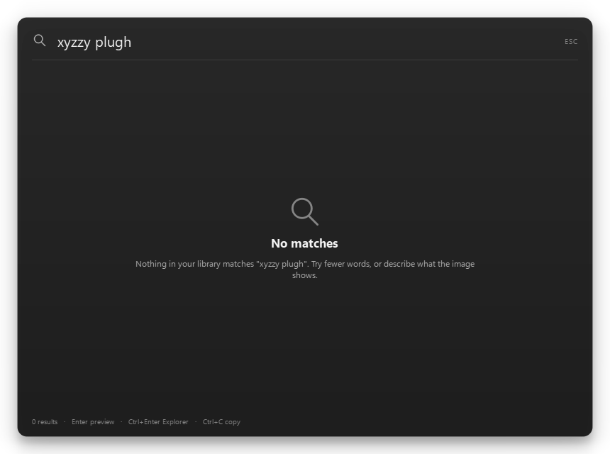
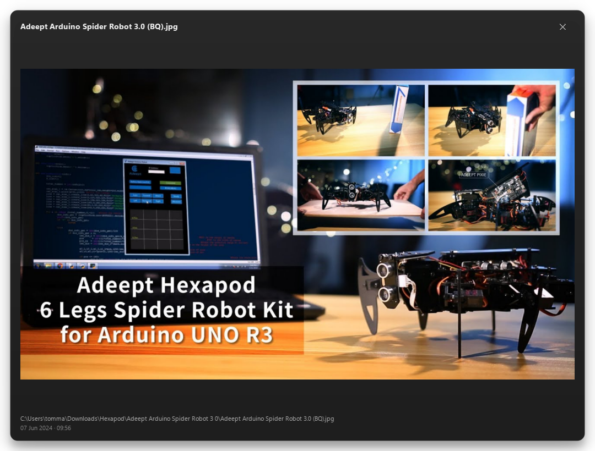

# ShotFinder

Find any screenshot, photo or video by what's written in it, what it shows, or what's said in it. Local, offline, multilingual. Windows.

ShotFinder indexes your folders into a single local SQLite file, then searches it with text you remember: a word from a screenshot, a description of a scene, or something said in a video. OCR reads text in images, a CLIP image encoder makes every image searchable by meaning, and a multilingual text encoder lets you query in Italian or English against the same visual space. Nothing leaves your machine.

## Status

Phase 3 of 6. Working today:

- Folder scanning, live file watching, hash-based move/rename detection.
- Windows OCR on images, stored in full-text search.
- CLIP visual embeddings for images, stored in a local vector index.
- Hybrid search that merges full-text and visual results (reciprocal rank fusion), with `--explain` showing the raw text rank and cosine similarity per result.
- A tray app with a Spotlight-style search window, keyboard navigation, preview, copy and reveal.
- Model download with SHA-256 verification and resume, from the CLI or the tray.

Not built yet: video frame and speech indexing (Phase 4), packaging and first-run setup (Phases 5-6). Videos are detected and listed, but no frames or audio are read yet and the preview opens them in your own player.

## Requirements

- Windows 10 or 11, x64.
- Python 3.11 or newer.

## Install

```powershell
git clone https://github.com/brighinatommaso-eng/shotfinder.git
cd shotfinder
python -m venv .venv
.\.venv\Scripts\Activate.ps1
pip install -e .
```

## Download the models

```powershell
python -m shotfinder.cli models download
```

That fetches about 467 MB into `%LOCALAPPDATA%\ShotFinder\models`: the CLIP image encoder (335 MB), the multilingual text encoder (129 MB) and its tokenizer (3 MB). Files are verified against pinned SHA-256 hashes and can resume after an interruption. `python -m shotfinder.cli models status` shows what is present.

Without the models, indexing still runs OCR and search still returns text matches. The tray app offers to download them too: when they are missing it shows a notification, and the tray menu has a "Download models" item with progress in the tooltip. Text search works while that runs.

## Run the app

```powershell
python -m shotfinder
```

ShotFinder starts in the tray and indexes in the background; the tooltip shows `Idle`, `Indexing 132/2,048`, `Paused` or `Models missing`. `Ctrl+Alt+Space` opens the search window, and so do the tray icon and its menu. A second launch does not start a second copy: it asks the running one to show its window.

If another app already owns `Ctrl+Alt+Space`, ShotFinder tells you once and stays usable from the tray. The menu also pauses or resumes indexing, opens the data folder and quits.

| Key | Action |
| --- | --- |
| Arrows | Move between results |
| `Enter` | Preview the selected file |
| `Ctrl+Enter` | Show the file in Explorer |
| `Ctrl+C` | Copy the image to the clipboard |
| `Esc` | Close the window |

Typing is debounced by 250 ms and searches run off the UI thread, so a slow query never blocks the window. An empty query lists recent files; a query with no hits explains what was searched instead of showing a blank panel.






## Use from the command line

```powershell
# Scan the watched folders and index new or changed files
python -m shotfinder.cli index

# Search by text in a screenshot, or by what an image shows
python -m shotfinder.cli search "fattura enel"
python -m shotfinder.cli search "spiaggia al tramonto"
python -m shotfinder.cli search "spiaggia al tramonto" --explain

# Most recent indexed files
python -m shotfinder.cli search
```

The first run watches the folders that exist among the Windows Pictures, Screenshots, Videos and Downloads known folders, so OneDrive redirection and localised folder names are handled. To change them, edit `watched_folders` in `%LOCALAPPDATA%\ShotFinder\config.json` and run `index` again. `--data-dir` points the CLI at a different data directory.

Files that exist only in the cloud are never downloaded or read: they are marked `skipped` with the reason `cloud-only` and picked up on a later scan once they are on disk.

## Privacy

Indexing and search are entirely local. The database, models, logs and thumbnail cache live under `%LOCALAPPDATA%\ShotFinder`; the only network access is the one-time model download. No telemetry, no accounts, no uploads.

## Built for Hack Club Stardance

Built for [Hack Club Stardance](https://stardance.hackclub.com).

## License

MIT. The model files are distributed separately on the `models-v1` release; their upstream licenses are listed there.
